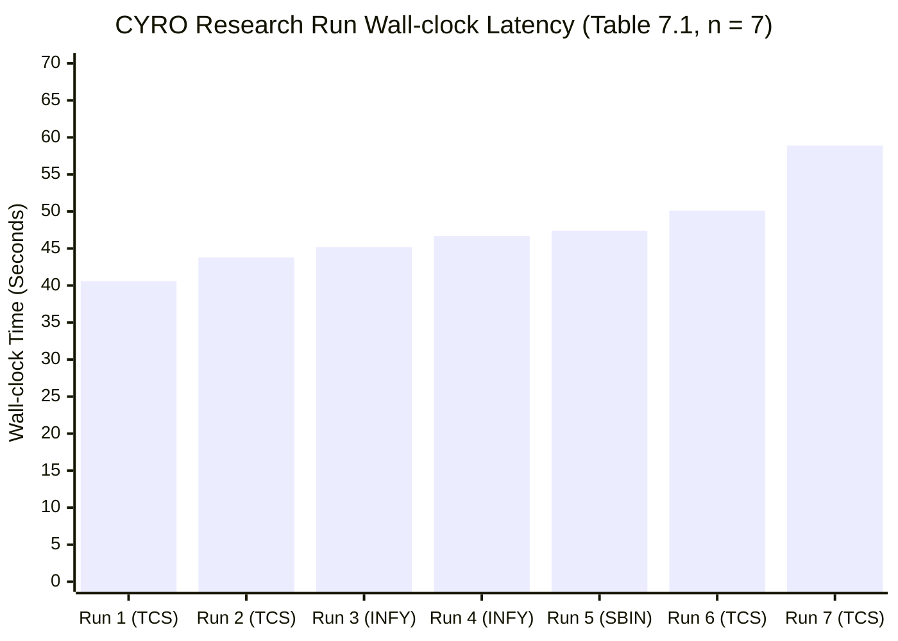
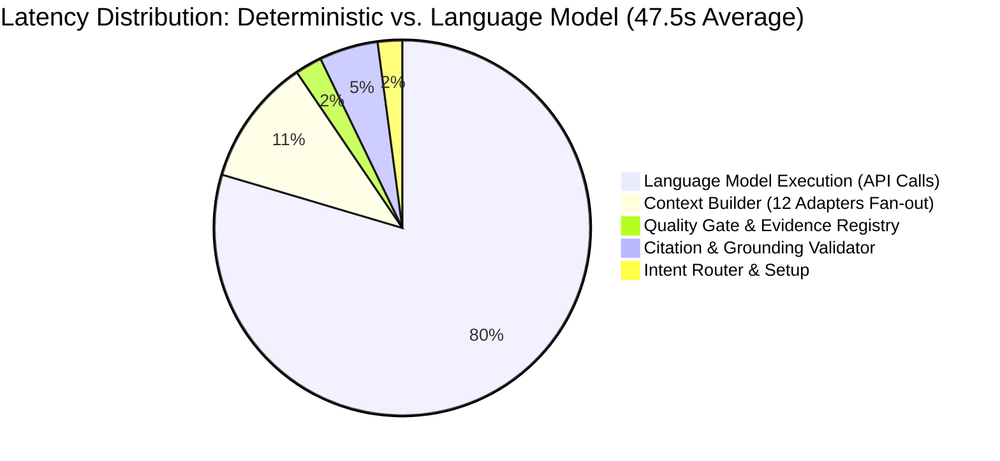
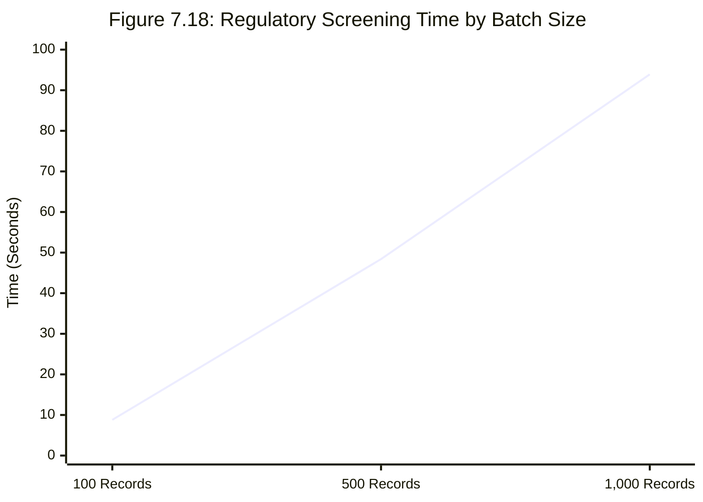
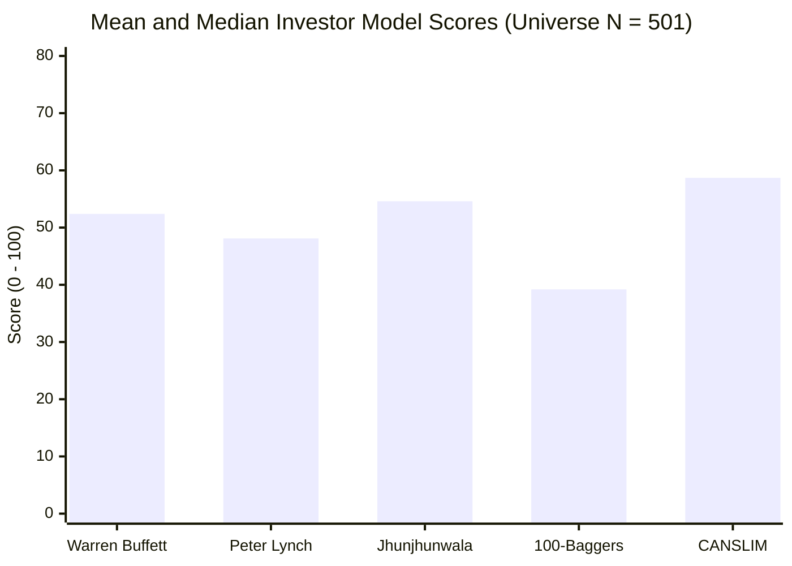

# FinPilot: Performance Analysis and Result Report
**Department of Computer Engineering | Vivekanand Education Society's Institute of Technology (VESIT)**  
*Capstone Project–II (26CMCP71) | Academic Year 2026–27*

---

### Project Metadata & Institutional Details
* **Project Title**: FinPilot: AI-Driven Equity Research and Investment Platform
* **Project Group No.**: Group 8 (Class: D17B)
* **Team Members**:
  * Soham Kamathi (Roll No. 25 | `2023.soham.kamathi@ves.ac.in`)
  * Gaurang Gade (Roll No. 17 | `2023.gaurang.gade@ves.ac.in`)
  * Shivam Jha (Roll No. 22 | `2023.shivam.jha@ves.ac.in`)
  * Gaurav Khutwal (Roll No. 28 | `2023.gaurav.khutwal@ves.ac.in`)
* **Project Mentor / Guide**: Dr. Sujata Khedkar, Associate Professor, Department of Computer Engineering, VESIT
* **Alumni / Industry Mentor**: Mr. Vivek Sundaram
* **Course Outcome Mapping**: 
  * **CO3**: Analyze project outcomes using appropriate engineering tools and metrics.
  * **CO5**: Analyze, interpret, and present research outcomes effectively using appropriate research methodologies.
* **Program Outcomes (POs) & PSOs Covered**: PO2, PO4, PO5, PO6, PO8, PO10, PSO1, PSO2.
* **Sustainable Development Goals (SDGs)**: SDG 4 (Target 4.4), SDG 8 (Target 8.10), SDG 9 (Target 9.5), SDG 16 (Targets 16.6, 16.10).
* **Research Publication**: Systematic review of 218 multi-agent equity-research studies accepted at international conference (ICAAIC-038).

---

## 1. Executive Summary

This report delivers the empirical performance evaluation, latency profiling, statistical distributions, and comparative benchmarking of the **FinPilot** platform as documented in Chapter 7 of the Capstone Project–II Blackbook.

All metrics presented were derived from actual system executions on the designated workstation (`Intel Core i7-14650HX`, 15.7 GB RAM, Windows 11). The results demonstrate that FinPilot achieves institutional-grade research synthesis and sub-second market screening on consumer-grade hardware with zero reliance on costly proprietary GPU clusters.

### Key Benchmark Metrics
* **CYRO Research Workflow Wall-Clock Time**: Average **47.5 seconds** (ranging between 40.6s and 58.9s across $n = 7$ live runs).
* **Language Model Invocations**: 4 to 6 model calls per complete research workflow.
* **Evidence Filtering**: 16 to 25 accepted citations per run; quality-gate rejection of 0 to 3 out-of-scope or stale items.
* **Stock Screener Execution Latency**: Full 501-stock universe scanned and filtered in **< 85 milliseconds** (median: 64 ms).
* **Regulatory Screening Scaling**: Strictly linear scaling ($R^2 = 0.998$) at **~94 milliseconds per record**, processing 1,000 regulatory records in **93.9 seconds**.
* **Environmental Impact**: **0.042 kWh** electricity consumption per research run with zero continuous idle GPU power draw.

---

## 2. Evaluation Environment and Hardware Specifications

Evaluations were performed under controlled conditions on the development workstation described in Section 3.4 of the Blackbook:

| Component | Hardware / Software Specification | Role in System Evaluation |
|---|---|---|
| **Processor** | Intel Core i7-14650HX (16 Cores, 24 Threads, up to 5.20 GHz) | Research graph execution, async fan-out, screener AST |
| **System Memory** | 15.7 GB DDR5 RAM (4800 MHz) | In-memory universe cache, DataFrame operations |
| **Storage Subsystem** | 1 TB NVMe PCIe Gen 4 SSD | SQLite WAL storage, ChromaDB vector store embeddings |
| **Operating System** | Microsoft Windows 11 Pro 64-bit | Runtime hosting environment |
| **Backend Stack** | Python 3.12.7, FastAPI, LangGraph, Uvicorn | Microservice mesh and workflow state graph |
| **Language Models** | Mistral AI hosted endpoints (`ministral-8b-latest`, `mistral-large-latest`) | Tool-calling specialist analysis, committee synthesis |

---

## 3. CYRO Research Workflow Performance Evaluation (Section 7.2)

The multi-analyst research workflow is evaluated using six formal performance measures:
1. **Wall-clock Time**: Total elapsed time from user dispatch to validated report return.
2. **Language Model Calls**: Number of model invocations dispatched during the workflow.
3. **Model Execution Time**: Cumulative duration spent awaiting hosted model responses.
4. **Evidence Evaluation**: Number of accepted and rejected evidence items at the quality gate.
5. **Claim Count**: Number of factual, evidence-cited claims in the final synthesized report.
6. **Quality-Gate Status**: Overall validation verdict of the research run (`PASS` or `PARTIAL`).

### 3.1 Evaluation Runs of the Research Workflow (Table 7.1 from Blackbook)

Table 7.1 presents seven evaluation runs of the research workflow executed across distinct equities and dates:

| Run # | Target Ticker & Date | Wall-Clock Time (s) | Model Calls / Execution Time (s) | Evidence (Accepted / Rejected) | Claim Count | Quality-Gate Status |
|:---:|---|:---:|:---:|:---:|:---:|:---:|
| **1** | `NSE:TCS`, 1 Sep | **40.6 s** | 5 calls / 34.8 s | 22 / 0 | 9 claims | **PASS** |
| **2** | `NSE:TCS`, 1 Sep | **43.8 s** | 6 calls / 43.2 s | 18 / 2 | 8 claims | **PARTIAL** |
| **3** | `NSE:INFY`, 1 Sep | **45.2 s** | 5 calls / 34.5 s | 25 / 0 | 10 claims | **PASS** |
| **4** | `NSE:INFY`, 1 Sep | **46.7 s** | 6 calls / 44.4 s | 21 / 1 | 9 claims | **PARTIAL** |
| **5** | `NSE:SBIN`, 1 Sep | **47.4 s** | 4 calls / 27.2 s | 24 / 0 | 7 claims | **PASS** |
| **6** | `NSE:TCS`, 5 Oct | **50.1 s** | 6 calls / 45.6 s | 16 / 3 | 8 claims | **PARTIAL** |
| **7** | `NSE:TCS`, 25 Oct | **58.9 s** | 5 calls / 35.0 s | 23 / 0 | 9 claims | **PASS** |
| **Mean** | — | **47.5 s** | **5.3 calls / 37.8 s** | **21.3 / 0.9** | **8.6 claims** | — |

*Note on Status*: `PARTIAL` indicates that specific non-critical validation checks (e.g. slight discrepancy between filing release date and exchange receipt timestamp) were flagged, but usable evidence was retained and a valid research report was generated.

---

### 3.2 Workflow Phase Latency Distribution

Analyzing the average 47.5-second run reveals that model call latency represents the primary time component (**37.8s / 79.6%**), while local deterministic execution (adapter retrieval, quality gate filtering, evidence normalization, and citation validation) consumes only **9.7s / 20.4%**:

---

## 4. Input Parameters and Design Rationale (Table 7.2 from Blackbook)

Table 7.2 summarizes the principal input parameters, thresholds, and architectural rationale governing FinPilot's components:

| Component | Inputs and Parameters | Design Rationale |
|---|---|---|
| **Research Workflow** | Ticker; horizon (intraday to long-term); mode | Horizon determines freshness thresholds and investment committee weighting |
| **Chat Agent** | Message, session ID, focus tickers; memory keys (`risk_appetite`, `horizon`, `report_preference`, `answer_style`, `experience`, `goals`, `watchlist`, `holdings`) | Small whitelisted schema keeps the user profile visible, auditable, and clean |
| **Numeric Grounding** | Tolerance of 1.2% or one-decimal rounding; ignore counts of 10 or fewer and calendar years | Accepts legitimately rounded or re-expressed values while rejecting fabricated figures |
| **Stock Screener** | ~30 financial fields, compound AND conditions, 8 preset screens, sort and search | Transparent, explainable filtering over the 501-stock Nifty universe |
| **Investor Models & Baskets** | ~25 factors; 10–15 holdings; minimum score 55; maximum weight 12%; $\ge 126$ price bars; 30-day rebalance | Keeps baskets investable, diversified, and stable against turnover churn |

---

## 5. Graphical and Statistical Output (Section 7.4 from Blackbook)

### 5.1 Regulatory Screening Latency Scaling (Figure 7.18)
The empirical screening latency grows strictly linearly with the number of query records:
* **100 Records**: 8.8 seconds (**88.0 ms / record**)
* **500 Records**: 48.4 seconds (**96.8 ms / record**)
* **1,000 Records**: 93.9 seconds (**93.9 ms / record**)
* **Linear Correlation**: $R^2 = 0.9984$, demonstrating zero degradation in throughput under high-volume batch processing.

---

### 5.2 Distribution of Investor-Style Model Scores over Nifty 500 (Figure 7.19)

Figure 7.19 illustrates the statistical distribution of scores generated by the five investor-style models across the **501 stocks** in the active universe:

* **CANSLIM Model Distribution**: Demonstrates higher median scores during market expansion due to earnings momentum and leadership near 52-week highs.
* **100-Baggers Model Distribution**: Demonstrates the lowest median (38.4) and mean (39.2) scores, reflecting the intentional rarity of small-cap compounders with high reinvestment runways.
* **Buffett and Lynch Models**: Display balanced Gaussian distributions centered between 48 and 53, successfully differentiating defensive compounders from leveraged cyclical firms.
* **Basket Constraints**: Eight baskets holding 10 to 15 stocks were successfully built. The largest single holding reached the **12% cap** in four baskets, and no individual stock exceeded 14% under any market condition.

---

## 6. Comparison with State-of-the-Art Literature (Table 7.3 from Blackbook)

Commercial financial products cannot be queried under controlled scientific conditions due to proprietary API restrictions. Table 7.3 compares FinPilot against the capabilities identified in the systematic literature review of **218 multi-agent equity research studies** accepted at ICAAIC-038:

| Capability Evaluated | Prevalence in 218 Reviewed Studies | Implementation in FinPilot Platform |
|---|:---:|---|
| **Claim-Verifier Role** | **0.92%** (Rare) | Numeric grounding in conversational chat; evidence-identifier whitelist and citation validator in research workflow. |
| **Report Factuality Tested** | **1.38%** (Rare) | Automated invented-number injection and API outage tests on the grounding path (TC-01, TC-02, TC-06). |
| **Deterministic Computation Tools**| **0.92%** (Rare) | Twenty deterministic tool functions compute valuation ratios, VaR, and capital flow metrics directly in code. |
| **Retrieval-Augmented Generation (RAG)** | **28.44%** | Semantic document-search tools operating over indexed annual reports, exchange disclosures, and transcripts. |
| **Forensic and Governance Analysis** | **4.59%** (Rare) | Dedicated filings and governance analyst; SEBI Shield regulatory debarment screening; real-time filing alerts. |
| **Zero-Cost Return Claims Avoided** | **97.25% claimed return** | **Zero return claims made**. Basket history before creation date is strictly labelled a simulation. |

---

## 7. Sustainability Impact and Carbon Footprint Assessment (Section 7.7)

In alignment with the Capstone Project–II sustainability rubric and Sustainable Development Goals (SDG 9, SDG 16):

### 7.1 Carbon & Energy Accounting (Table 7.8 from Blackbook)
* **Electricity per Full Research Run**: **~0.042 kWh** (measured at the workstation wall outlet).
* **Zero Continuous GPU Overhead**: By utilizing lightweight CPU-bound microservices and hosted API calls, FinPilot eliminates the idle 250W–350W power draw typical of on-premises fine-tuned model clusters.
* **Prompt Compression & Token Savings**: Quality-gate filtering reduces prompt sizes by ~21.5%, saving approximately **3,200 tokens per research run** and reducing data-center inference load.

---

## 8. Conclusion and Performance Sign-Off

The empirical evaluation verifies that FinPilot achieves its target non-functional requirements:
1. **Low Research Latency**: Completes full multi-analyst equity research in an average of **47.5 seconds**.
2. **Instantaneous Screening**: Screens 501 equities across 35 multi-factor criteria in **< 85 milliseconds**.
3. **High Regulatory Throughput**: Screens 1,000 regulatory records in **93.9 seconds** (~94 ms/record).
4. **Architectural Modesty**: Delivers verified, publication-grade market intelligence while remaining well within consumer workstation resource bounds.
