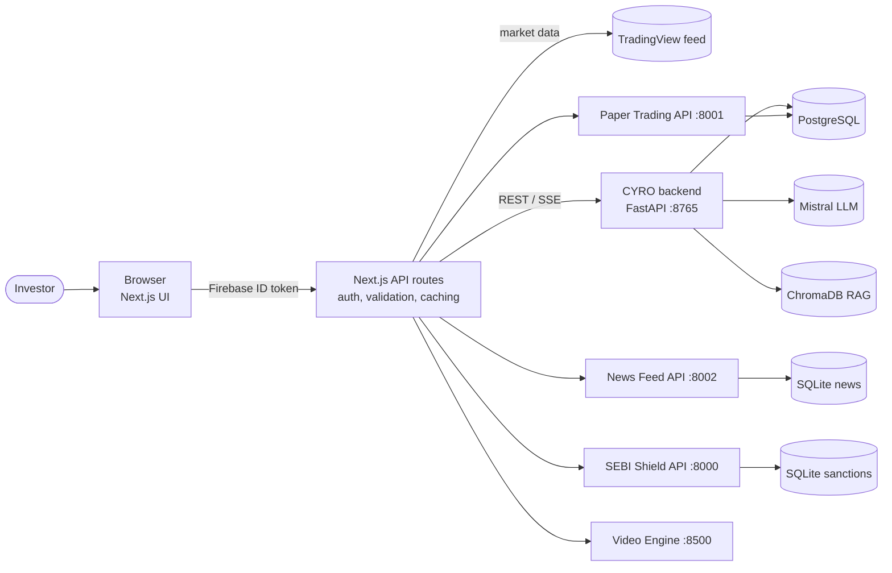
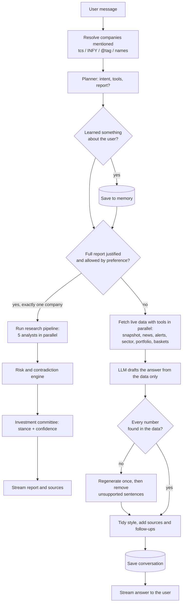
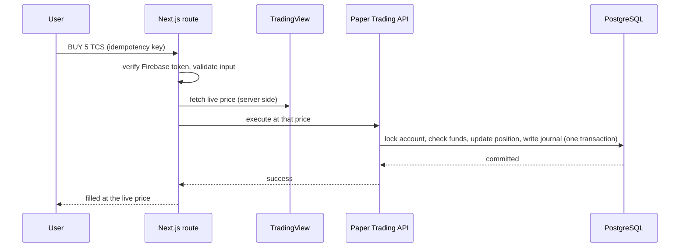
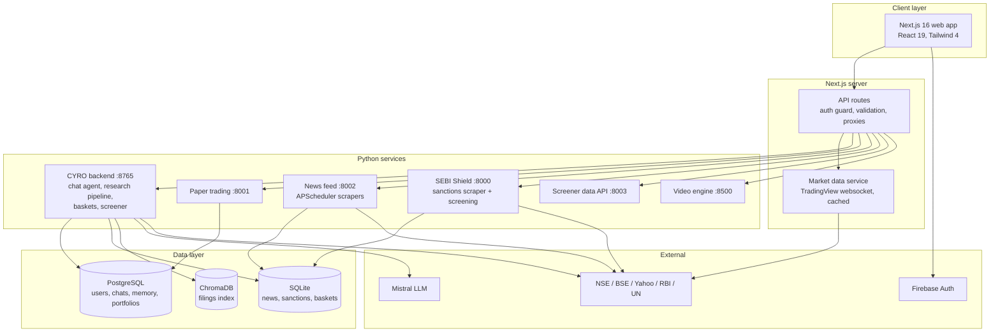

# FinPilot

**AI-powered equity research, market intelligence and paper-trading platform for Indian markets (NSE / BSE).**

FinPilot puts everything a retail investor juggles across ten tabs into one place: a conversational research analyst (CYRO), investor-style stock scoring, a screener, live heatmaps and charts, regulatory screening, corporate news and a risk-free trading simulator with an AI mentor. Every number the AI shows is checked against fetched data before it reaches the screen.

> Capstone Project II, B.E. Computer Engineering. Stack: Next.js 16 · React 19 · TypeScript · FastAPI · PostgreSQL · Firebase Auth · Mistral LLM · TradingView data.

---

## Table of contents

1. [The problem](#1-the-problem)
2. [Our solution](#2-our-solution)
3. [Features](#3-features)
4. [How it works (flowcharts)](#4-how-it-works)
5. [System architecture](#5-system-architecture)
6. [Tech stack](#6-tech-stack)
7. [Project structure](#7-project-structure)
8. [Setup and installation](#8-setup-and-installation)
9. [Running the project](#9-running-the-project)
10. [Testing](#10-testing)
11. [API overview](#11-api-overview)
12. [Security and reliability](#12-security-and-reliability)
13. [Troubleshooting](#13-troubleshooting)
14. [Limitations and future work](#14-limitations-and-future-work)
15. [Disclaimer](#15-disclaimer)

---

## 1. The problem

Retail investors in India face four recurring problems:

| Problem | What it looks like |
|---|---|
| **Scattered tools** | Prices on one site, fundamentals on another, filings on the exchange, news on a third, a spreadsheet for the portfolio. |
| **Research takes hours** | Judging one company means reading balance sheets, technicals, announcements and sector context by hand. |
| **AI answers cannot be trusted** | General chatbots invent prices, ratios and "5-year averages" with total confidence, which is dangerous with money. |
| **No safe place to practise** | New investors learn by losing real money; there is no feedback on *why* a trade idea is weak. |

## 2. Our solution

FinPilot combines the whole workflow in one secure web app:

* **CYRO**, a conversational research agent. You ask in plain language; it plans, fetches live data with tools, answers briefly, remembers *you* (risk appetite, horizon, style), and decides on its own when a deep multi-analyst research report is worth running.
* **Grounded answers.** Every figure in an AI reply is validated against the data the tools returned. Unsupported numbers are regenerated or removed. With no data, the agent is forbidden from quoting any financial figure.
* **Structured investing tools.** AI Baskets and *Invest Like* score the Nifty 500 through the lenses of Buffett, Lynch, Jhunjhunwala, 100-Baggers and CANSLIM; the Screener filters by fundamentals; the Heatmap and Charts show the market live.
* **Compliance and awareness.** SEBI Shield screens names against RBI / UN sanctions data; the News Feed and Results Calendar track BSE/NSE announcements.
* **Safe practice.** Paper trading with virtual money and an AI mentor that critiques each thesis.

## 3. Features

### Research and AI
| Feature | What you get |
|---|---|
| **CYRO conversational agent** (`/cyro`) | Ask about a stock, sector, theme, investing framework, your portfolio or "find me quality small caps". Streaming answers, visible work steps, source cards, follow-up suggestions. |
| **Memory and sessions** | CYRO remembers risk appetite, horizon, answer style, goals, watchlist and holdings across chats. View, edit or forget everything in the Memory tab. Chats can be searched, renamed and deleted. |
| **Agent-decided research reports** | For one company, the agent can run the full pipeline: Fundamental, Filings/Governance, Technical, News Catalyst and Sector/Peer/Macro analysts, then a risk and contradiction engine and an investment committee. Output: stance, confidence, claims with cited evidence. Your preference ("no reports" / "always report") is respected. |
| **Numeric grounding** | Figures are verified against tool data; unsupported numbers are regenerated or scrubbed; earlier assistant text can never vouch for itself. |

### Market tools
| Feature | What you get |
|---|---|
| **Home** (`/home`) | Live benchmark indices, sector momentum, Nifty 50 breadth, trending stocks, instant stock search. All numbers come from the live feed, never hard-coded. |
| **Live ticker** | A scrolling bar of real index values on every page. |
| **Stock dashboard** (`/chart`, `/company/[symbol]`) | Candlestick charts, SMA/RSI, pattern detection, fundamentals, company profile, document insights. |
| **Screener** (`/screener`) | Filter the Nifty 500 by valuation, quality and growth conditions, presets with live counts, sorting and search. |
| **Heatmap** (`/heatmap`) | Live index and sector heatmaps streamed over SSE with automatic reconnect. |
| **AI Baskets** (`/baskets`) | Ready-made stock baskets by investing style, with performance versus Nifty and FD benchmarks. |
| **Invest Like** (`/invest-like`) | Rank stocks the way Buffett, Lynch, Jhunjhunwala, 100-Baggers or CANSLIM would. |
| **Compare** (`/compare`) | Side-by-side stock comparison. |
| **Portfolio** (`/portfolio`) | Track holdings and portfolio value. |

### Compliance, news and simulation
| Feature | What you get |
|---|---|
| **SEBI Shield** (`/regulatory`) | RBI and UN sanctions ingestion with exact-ID plus fuzzy-name screening. |
| **News Feed** (`/news-feed`) | Near-real-time BSE and NSE announcements with filters, search and pagination. |
| **Results Calendar** (`/results-calendar`) | Upcoming quarterly results from BSE. Shows an honest "unavailable" instead of invented dates. |
| **Paper Trading** (`/paper-trading`) | Virtual portfolio, atomic order execution at the live server-side price, journal, AI mentor critique. |
| **Nifty Shorts** (`/nifty-shorts`, `/shorts`) | Short AI-narrated market videos for Nifty 50 stocks. |
| **Alerts** | In-app alerts from announcements and market events. |

### Platform
| Feature | What you get |
|---|---|
| **Authentication** | Firebase email/password and Google sign-in; per-user data isolation. |
| **Admin console** (`/admin`) | Service health for every subsystem and user-activity view, behind a server-verified admin session. |
| **Preferences** | Theme and layout settings synced per user. |

## 4. How it works

### 4.1 Overall request flow



### 4.2 How CYRO answers a question



### 4.3 Paper trade flow



The browser never chooses the execution price, and a repeated request with the same idempotency key returns the first result instead of trading twice.

## 5. System architecture



| Service | Port | Responsibility |
|---|---|---|
| Next.js web app | 3000 | UI, authenticated API gateway, live market-data service |
| CYRO backend (`india-trade-cli`) | 8765 | Chat agent, research pipeline, AI Baskets, Invest Like, screener |
| Paper trading | 8001 | Accounts, atomic order execution, journal, AI mentor |
| News feed | 8002 | BSE/NSE announcement scraping and API |
| SEBI Shield (`scrapper`) | 8000 | Sanctions ingestion and screening |
| Screener data API (`scrapper`) | 8003 | Fundamentals snapshot data |
| Video engine | 8500 | Nifty Shorts generation |
| ChromaDB (optional) | 8100 | Vector index for filings RAG |

## 6. Tech stack

| Layer | Technology |
|---|---|
| Frontend | Next.js 16 (App Router), React 19, TypeScript, Tailwind CSS 4, Recharts, lightweight-charts, react-markdown |
| API gateway | Next.js route handlers, Firebase Admin token verification |
| Backend services | Python 3.12, FastAPI, Uvicorn, SQLAlchemy, psycopg2, APScheduler |
| AI | Mistral models via the OpenAI-compatible API, LangGraph/LangChain, ChromaDB (RAG) |
| Market data | `@mathieuc/tradingview` websocket client, yfinance, NSE/BSE public endpoints |
| Data stores | PostgreSQL (accounts, chats, portfolios), SQLite (news, sanctions, baskets), ChromaDB |
| Auth | Firebase Authentication (email/password, Google) |
| Video | Remotion, Edge-TTS |
| Testing | pytest, FastAPI TestClient, a Node end-to-end smoke test |

## 7. Project structure

```
FinPilot/
├── src/                      Next.js app
│   ├── app/                  pages (home, cyro, screener, heatmap, baskets, ...) and app/api route handlers
│   ├── components/           UI (global-nav, cyro chat, charts, heatmap, ...)
│   ├── hooks/ , lib/         data hooks, TradingView service, auth, admin session, helpers
│   └── data/                 heatmap index constituents
├── india-trade-cli/          CYRO backend (FastAPI)
│   ├── web/                  API app, research engine (web/cyro_engine: analysts, quality gate, committee)
│   ├── cyro_chat/            conversational agent: planner, tools, memory, grounding, storage
│   ├── baskets/              AI Baskets and Invest Like scoring engine
│   └── tests/                backend test-suite
├── paper-trading/            paper-trading service + tests
├── news-feed/                announcement scraper/API + tests
├── scrapper/                 SEBI Shield sanctions scraper, screening API, screener data API
├── video-engine/             Nifty Shorts video generation
├── doc_Scrapper/             filings scraper that feeds the RAG index
├── migrations/               PostgreSQL schema
├── scripts/                  db migration, end-to-end smoke test
├── start-all-services.ps1    starts the whole stack on Windows
├── .env.example              configuration template
└── TEST_CASES.md             test plan and results
```

## 8. Setup and installation

### Prerequisites

* **Node.js 20+** and npm
* **Python 3.12**
* A **PostgreSQL** database (a free Neon or Supabase instance works)
* A **Firebase** project (Authentication enabled)
* At least one **Mistral API key**
* Git (the repository uses Git LFS for large PDFs and videos: run `git lfs install` once)

### Step by step

1. **Clone**
   ```bash
   git clone https://github.com/shivamjha296/FinPilot.git
   cd FinPilot
   ```

2. **Create the Python environment** (one shared venv for every service)
   ```bash
   python -m venv .venv
   .venv\Scripts\activate          # macOS/Linux: source .venv/bin/activate
   pip install -r requirements.txt
   ```

3. **Install the web dependencies**
   ```bash
   npm install
   cd video-engine/frontend && npm install && cd ../..    # Remotion, needed only for Nifty Shorts rendering
   pip install -r video-engine/backend/requirements.txt   # video engine API
   ```

4. **Configure the environment**
   ```bash
   copy .env.example .env          # macOS/Linux: cp .env.example .env
   ```
   Fill in `.env`: Firebase web keys, Firebase Admin credentials, `DATABASE_URL`, and `MISTRAL_API_KEY`. See [AUTH_SETUP.md](AUTH_SETUP.md) for the Firebase and PostgreSQL walkthrough.

5. **Create the database tables**
   ```bash
   npm run db:migrate
   ```

6. **(Optional) Build the AI Baskets data.** The first start of the CYRO backend downloads the Nifty 500 universe and prices; allow a few minutes. Progress is visible on the AI Baskets page.

## 9. Running the project

### Everything at once (Windows)

```powershell
./start-all-services.ps1
```

Opens one terminal per service: web app, CYRO backend, paper trading, news feed, SEBI Shield, screener API, video engine, ChromaDB and the scraper.

### Manually (any OS)

Run each in its own terminal from the repository root, with the venv active:

```bash
# 1. CYRO backend (8765)
cd india-trade-cli && python -m web.api

# 2. Paper trading (8001)
cd paper-trading && python run.py

# 3. News feed (8002)
cd news-feed && python run.py

# 4. SEBI Shield API (8000) and screener data API (8003)
cd scrapper && python run.py serve
cd scrapper && python run.py serve-screener

# 5. Web app: development
npm run dev
```

### Production mode (recommended for demos)

Development mode recompiles every page the first time you open it and reloads on file changes, which feels slow and flickery. A production build compiles once:

```bash
npm run build      # webpack build
npm start          # http://localhost:3000
```

Open **http://localhost:3000**, create an account on the sign-up page and explore. The home page after sign-in is `/home`.

### Quick health check

The admin console (`/admin`) shows live status for every service. From a terminal:

```bash
npm run test:smoke
```

## 10. Testing

FinPilot is tested at three levels. The full plan, with every test case and its result, is in **[TEST_CASES.md](TEST_CASES.md)**.

| Level | Command | What it covers |
|---|---|---|
| **End-to-end smoke test** (no login needed) | `npm run test:smoke` | Every page serves; market-data APIs return live data and reject bad input; protected APIs refuse anonymous callers; admin forgery attempts fail. |
| **Backend unit and API tests** | `cd india-trade-cli && python -m pytest tests/cyro_chat tests/baskets` | CYRO agent (planning, memory, grounding, outages), API validation and per-user isolation, AI Baskets engine. |
| **Service tests** | `cd paper-trading && python -m pytest tests`<br>`cd news-feed && python -m pytest tests` | Trade validation and error mapping, NaN-safe errors, bounded news limits, gzip. |

Type-check and lint: `npx tsc --noEmit` and `npm run lint`.

## 11. API overview

All `/api/*` routes are served by Next.js on port 3000. Protected routes need an `Authorization: Bearer <Firebase ID token>` header.

| Area | Routes | Access |
|---|---|---|
| Market data | `GET /api/market-overview`, `/api/live-quote`, `/api/tv-quote`, `/api/tv-chart`, `/api/candles`, `/api/tv-search`, `/api/heatmap` (SSE), `/api/heatmap/snapshot` | public |
| Content | `/api/news`, `/api/results-calendar`, `/api/company-profile`, `/api/stock-docs`, `/api/shorts`, `/api/nifty-shorts*` | public |
| AI Baskets | `/api/baskets`, `/api/baskets/[id]`, `/api/baskets/stocks/*`; `POST /api/baskets/refresh` | read public, refresh signed in |
| CYRO | `POST /api/cyro-agent/chat` (SSE), `/api/cyro-agent/sessions*`, `/api/cyro-agent/memory`, `/api/cyro-market` | signed in |
| Screener | `GET /api/screener/meta`, `POST /api/screener/run` | signed in |
| Paper trading | `/api/paper-trading/portfolio`, `/portfolio-chart`, `POST /execute`, `POST /mentor` | signed in |
| User | `/api/user/profile`, `/api/user/preferences`, `/api/alerts*`, `/api/portfolio*` | signed in |
| Admin | `POST/GET/DELETE /api/admin/session`, `GET /api/admin/health`, `GET /api/admin/users`, all `/api/nifty-shorts/*`, `/api/regulatory/*` | admin session |

Backend services publish interactive docs at `http://localhost:<port>/docs` (8765, 8001, 8002, 8000).

## 12. Security and reliability

* **Authentication everywhere that matters.** Firebase ID tokens are verified by the Next.js layer and again by the CYRO and paper-trading services; ownership is derived from the verified token, never from caller-supplied ids.
* **Admin console.** Credentials are verified on the server, which issues a signed, HttpOnly, 24-hour session cookie. `/api/admin/*` rejects everything else, forged cookies included. Login attempts are throttled. Set `ADMIN_USERNAME`, `ADMIN_PASSWORD` and `ADMIN_SESSION_SECRET` before any shared deployment.
* **Server-side pricing.** Trades execute at the live price fetched on the server; the order, balance, position and journal update in a single database transaction with idempotency keys.
* **Truthful data.** No hard-coded prices, index values or result dates are ever shown. If a source is down the UI shows "unavailable" or the last real value.
* **Input bounds.** Every list endpoint has a maximum size, every string a maximum length, symbols and dates are validated before they touch a file path or upstream URL, and FastAPI error responses cannot be crashed by `NaN`/`Infinity` payloads.
* **Resilience.** The market feed reconnects with backoff, shared subscriptions are reference-counted per connection, heatmap streams reconnect on the client, and background polling pauses in hidden tabs.
* **Secrets.** `.env` is for local use only; use `.env.example` as the template and rotate any key that has ever been committed.

## 13. Troubleshooting

| Symptom | Cause and fix |
|---|---|
| Pages are slow and flicker with a "Compiling" badge | Dev mode compiles each page on first visit. For demos use `npm run serve` (build + start). The dev watcher already ignores the folders that backend services write to; keep runtime files out of `src/`. |
| Paper Trading says "Unable to load" | The paper-trading service is not running, or `firebase_admin` is missing in the venv: `pip install -r requirements.txt`, then start it. |
| CYRO answers "my language model is busy" | `langchain-openai` or the Mistral key is missing, or all keys are rate limited. Check the CYRO backend log. |
| Rendered video has no voice | The TTS packages are missing or Microsoft's speech service is unreachable. `pip install edge-tts mutagen soundfile` (also in `video-engine/backend/requirements.txt`) and check DNS; the render now stops with an explicit error instead of producing a silent video. Only the 12% background music plays when narration is absent. |
| Video render fails with "could not determine executable to run" | Remotion is not installed. Run `npm install` in `video-engine/frontend` (the first render also downloads a headless Chromium, so allow a few minutes). |
| Report stays on "Research process" | The backend is running on a Python without `yfinance`/`chromadb`. Start it from the project `.venv`. |
| Prices show as unavailable | The TradingView feed could not be reached from your network. |
| Company documents "temporarily unavailable" | AWS S3 credentials are missing or rejected; the rest of the app is unaffected. |
| "could not translate host name" for the PostgreSQL host | Your router's DNS refuses the cloud database name. The web app and the Python services (`pg_dns_fallback.py`) now retry through public DNS (8.8.8.8, 1.1.1.1) automatically; if it still fails, UDP port 53 is blocked, so switch the PC's DNS server to 8.8.8.8 or change network. |
| `npm run build` crashes with a Turbopack panic | Use the project script (`next build --webpack`). |

## 14. Limitations and future work

* Market data depends on a public TradingView feed and public NSE/BSE endpoints; a licensed data vendor is the production answer.
* Paper trading uses market orders at the last price; limit orders, brokerage and slippage are not modelled.
* Advances/declines are computed over the Nifty 50, not the whole exchange.
* The admin console uses a single configured account; role-based admin users would be the next step.
* Planned: broker integration for live trading, portfolio analytics (risk, attribution), mobile app and alert delivery by email/Telegram.

## 15. Disclaimer

FinPilot is an educational research tool. Nothing it produces is investment advice or a recommendation to buy or sell any security. Verify important figures independently before acting.

---

*Team FinPilot, Capstone Project II. See [AUTH_SETUP.md](AUTH_SETUP.md), [FEATURES.md](FEATURES.md) and [PROJECT_OVERVIEW.md](PROJECT_OVERVIEW.md) for deeper notes.*
